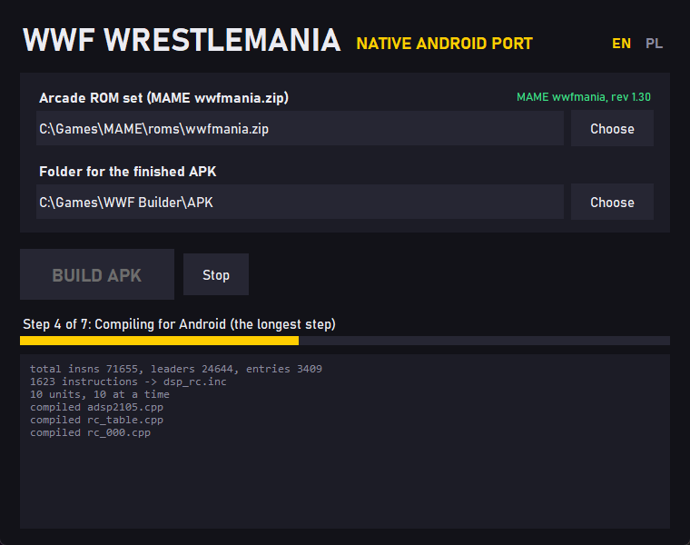

### WWF WrestleMania: native Android port (builder)

A native Android port of Midway's 1995 arcade game WWF WrestleMania (Wolf Unit hardware). The
game's TMS34010 program and the DCS sound board's ADSP-2105 program are statically recompiled to
C++ and compiled for arm64, so the arcade's own program runs as native code on the phone, with
touch controls, a pause menu with move lists, cheats and combo practice, and
two-phone MULTIPLAYER over Wi-Fi.

This repository holds the builder: one Windows program that makes the APK from your own MAME ROM
set. No game data is included and the builder downloads nothing; everything made from the ROM
set stays on your computer.

Po polsku: [docs/PORADNIK.md](docs/PORADNIK.md).



### How to build the APK

1. **Get the ROM set.** MAME's `wwfmania.zip`: WWF WrestleMania, **rev 1.30** (08/10/95), the
   parent set, from your own arcade board. The builder checks all 22 chips by their CRC-32, so
   renamed files, a subfolder or a merged set with the clones' files are fine. The older
   revisions (MAME's clones) are not accepted: the port's patches are made for rev 1.30's program.
2. **Build.** Run `WWFBuilder.exe` from the
   [latest release](https://github.com/gangg111/wwfnative-builder/releases/latest), choose the
   zip and click BUILD APK. The first start unpacks the builder to `%LOCALAPPDATA%\WWFBuilder`
   (under a minute); a build takes one to a few minutes, most of it compiling.
3. **Install** `WWF WrestleMania.apk` on an arm64 phone with Android 8.0 or newer. Keep the
   `key` folder next to the builder, so the next APK installs as an update.

The APK holds data from your ROM set: for your own private use only, do not share it.

### The same APK on every computer

For the same ROM set the builder makes the same game library, byte for byte, on any Windows PC:
the compiler, its flags and the order of the link are fixed, and the recompiled code carries no
paths or dates. The build's log prints the library's hash; for rev 1.30 it is

```
libwwfgame.so SHA-256: b66c7d50caa8514b4ce1906830f8dc9fd7bd316f21d21aafb188b69815aff4b3
```

which is the developer's own build. Each builder signs with its own key, made on its first run,
so APKs from different builders install side by side only after uninstalling, but they play
MULTIPLAYER with each other.

### What is inside

- the recompilers (Python) and the TMS34010 and ADSP-2100 CPU cores from MAME (BSD-3-Clause)
  that the recompiled code is compiled with;
- the Android NDK r26b's clang and lld, with only the headers and libraries the build reads;
- the rest of the port, prebuilt;
- the launcher icon and the OPTIONS screens' pictures, made with AI tools;
- CPython 3.12 for the window and the pipeline.

The full list with the licences: [THIRD_PARTY.txt](THIRD_PARTY.txt) and [licences/](licences).

### Terms

Personal, noncommercial use; no rights are claimed over the graphics; no warranty. The port's
touch controls and menus come from [t3native](https://github.com/gangg111/t3native) and the
Tekken3Remake project under the PolyForm Noncommercial License 1.0.0. Details:
[LICENSE.txt](LICENSE.txt).

WWF, WrestleMania and the wrestlers' names belong to their owners; Midway made the arcade game.
This project is not affiliated with or endorsed by any of them.
