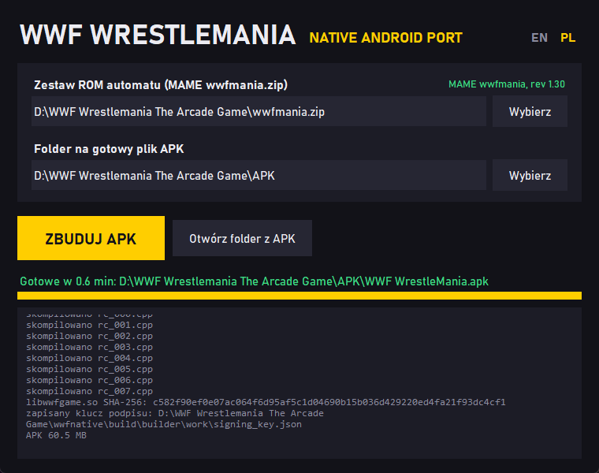

### WWF WrestleMania: natywny port na Androida (kompilator)

Natywny port gry z automatu WWF WrestleMania (Midway, 1995, sprzęt Wolf Unit). Program gry dla
procesora TMS34010 i program płyty dźwiękowej DCS (ADSP-2105) są statycznie przekompilowane do
C++ i skompilowane na arm64. Na telefonie działa więc własny program automatu jako natywny kod.
Port ma sterowanie dotykowe, menu pauzy z listą ciosów, kodami i treningiem combosów oraz
MULTIPLAYER na dwóch telefonach przez Wi-Fi.

To repozytorium zawiera kompilator: jeden program na Windows, który buduje plik APK z Twojego
własnego zestawu ROM z MAME. Nie ma w nim żadnych danych gry i niczego nie pobiera z internetu.
Wszystko, co powstaje z zestawu ROM, zostaje na Twoim komputerze.



### Jak zbudować APK

1. **Zestaw ROM.** Plik MAME `wwfmania.zip`: WWF WrestleMania, **rev 1.30** (08/10/95), zestaw
   główny, z Twojej płyty automatu. Kompilator sprawdza wszystkie 22 układy po sumach CRC-32,
   więc zmienione nazwy plików, podfolder albo zestaw „merged” z plikami klonów nie przeszkadzają.
   Starsze rewizje (klony w MAME) nie przejdą: poprawki portu są zrobione pod program rev 1.30.
2. **Budowa.** Uruchom `WWFBuilder.exe` z
   [najnowszego wydania](https://github.com/gangg111/wwfnative-builder/releases/latest), wskaż
   plik zip i kliknij ZBUDUJ APK (język okna przełącza EN / PL w rogu). Pierwszy start
   rozpakowuje kompilator do `%LOCALAPPDATA%\WWFBuilder` (do minuty), sama budowa trwa od minuty
   do kilku, głównie kompilacja.
3. **Instalacja.** Skopiuj `WWF WrestleMania.apk` na telefon arm64 z Androidem 8.0 lub nowszym
   i zainstaluj. Folder `key` obok kompilatora zachowaj: dzięki niemu następna wersja APK
   zainstaluje się jako aktualizacja.

Gotowy APK zawiera dane z Twojego zestawu ROM: jest tylko do Twojego prywatnego użytku, nie
udostępniaj go nikomu.

### Ten sam APK na każdym komputerze

Z tego samego zestawu ROM kompilator buduje na każdym komputerze z Windows tę samą bibliotekę
gry, bajt w bajt: kompilator, jego ustawienia i kolejność linkowania są stałe, a przekompilowany
kod nie zawiera ścieżek ani dat. Log budowy podaje skrót biblioteki; dla rev 1.30 wynosi

```
libwwfgame.so SHA-256: c582f90ef0e07ac064f6d95af5c1d04690b15b036d429220ed4fa21f93dc4cf1
```

i jest równy kompilacji autora. Każdy kompilator podpisuje własnym kluczem, tworzonym przy
pierwszej budowie, więc APK z różnych kompilatorów nie zainstalują się jedno na drugie bez
odinstalowania, ale grają ze sobą przez MULTIPLAYER.

### Warunki

Użytek własny i niekomercyjny, autor nie rości sobie praw do grafik, bez gwarancji. Sterowanie
dotykowe i menu portu pochodzą z [t3native](https://github.com/gangg111/t3native) i projektu
Tekken3Remake na licencji PolyForm Noncommercial 1.0.0. Szczegóły:
[LICENSE.txt](../LICENSE.txt), części innych autorów: [THIRD_PARTY.txt](../THIRD_PARTY.txt).

WWF, WrestleMania i nazwy zawodników należą do ich właścicieli, grę na automaty wydało Midway.
Projekt nie jest z nimi związany ani przez nich wspierany.
